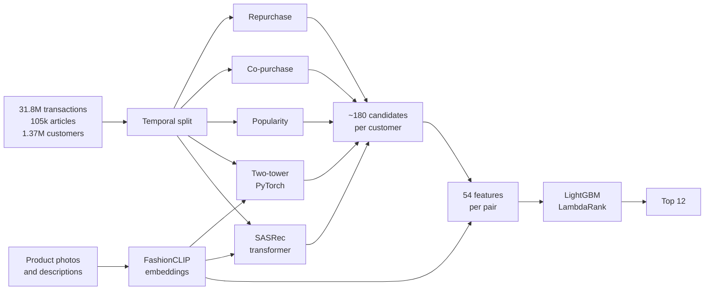

# H&M Fashion Recommender

A two-stage recommendation system trained on 31.8 million real transactions from H&M. For each customer it predicts the 12 articles they are most likely to buy next week, and serves those predictions through a real-time API.


## Results

Offline evaluation on a held-out week (72,019 customers who made a purchase). Every model only sees data from before that week.

| Model | MAP@12 | Recall@12 | Recall@100 |
|---|---|---|---|
| Popularity (last week) | 0.0066 | 0.021 | 0.099 |
| Repurchase | 0.0215 | 0.034 | 0.035 |
| Rule-based blend | 0.0268 | 0.056 | 0.137 |
| Two-tower alone | 0.0154 | 0.042 | 0.148 |
| SASRec alone | 0.0132 | 0.038 | 0.144 |
| Rules + two-tower + SASRec | 0.0272 | 0.058 | 0.159 |
| Two-tower + LightGBM ranker | 0.0359 | 0.076 | 0.177 |
| **Two-tower + SASRec + FashionCLIP + ranker** | **0.0367** | **0.078** | **0.188** |

The full model improves MAP@12 by 37% over the best rule-based approach, and 15.7% of customers buy at least one of the 12 articles they are shown. Neural retrievers are weaker than the rules on their own, but they surface articles the rules never propose: the share of next-week purchases present in the candidate set rises from 13.7% to 20.0%, and the ranker turns that into better top-12 lists.

## How it works



**Candidate generation.** A catalogue of 105k articles is too large to score with a heavy model for every customer, so several cheap sources each propose candidates. Three are simple rules: repurchase, co-purchase and recent popularity. The other two are neural retrievers that embed customers and articles in the same 128-dimensional space, so retrieval is a nearest-neighbour search:

- a **two-tower** model, where the customer tower pools their last 32 purchases with learned attention and adds recency and profile features;
- a **SASRec-style transformer** that reads the last 50 purchases in order, so it captures sequences such as jeans followed by a belt.

In both, the article tower combines the article ID, 12 catalogue attributes and a frozen **FashionCLIP** embedding of the product photo and description. The image signal lets a brand-new article be recommended before it has any sales. Both retrievers are trained with an in-batch softmax loss and logQ correction to avoid over-penalising popular items.

**Ranking.** A LightGBM LambdaRank model orders the candidates using 54 features: the score and rank given by each source, whether the customer already bought the article or the same model in another colour, recent sales and trend of the article, the price relative to the customer's usual spend, the similarity from each retriever, and the visual similarity between the article and the customer's recent purchases. The two strongest signals are the department of the article and how recently the customer bought the same model.

**Evaluation protocol.** Weeks are counted backwards from the last day of data. To evaluate week W, retrievers are trained on everything before W, and the ranker is trained on weeks W+1 and W+2 with retrievers that never saw those weeks. Nothing from the evaluated week leaks into training.

**Serving.** A FastAPI service loads the models once, encodes the customer on the fly, retrieves candidates with a FAISS HNSW index, computes features with the same code used in training, and returns the top 12 with a short explanation for each item. A Streamlit app shows a customer's recent purchases next to their recommendations.

## Tech stack

PyTorch (nightly, CUDA 12.8), Polars, DuckDB, LightGBM, FAISS, FastAPI, Streamlit, MLflow, Docker, GitHub Actions. Trained on a single RTX 5080 laptop GPU: about 2 minutes for the two-tower, 6 minutes for SASRec, 7 minutes to embed 105k product photos and about a minute for the ranker.

## Getting started

Requirements: Python 3.11+, an NVIDIA GPU for training (serving runs on CPU), and a Kaggle account. The dataset is not included in this repository: accept the rules of the [H&M competition](https://www.kaggle.com/competitions/h-and-m-personalized-fashion-recommendations) first.

```bash
# Environment (Windows PowerShell script, adapt the venv activation on Linux/macOS)
./setup_venv.ps1
pip install -e .

# Data (about 30 GB with product photos)
kaggle auth login
python scripts/run_download.py --images
python scripts/run_preprocess.py
python scripts/run_split.py
python scripts/run_embeddings.py

# Models (validation week)
python scripts/run_baselines.py
python scripts/run_train.py --model two_tower
python scripts/run_train.py --model sasrec
python scripts/run_train.py --model ranker

# Serving
python scripts/build_serving.py
uvicorn recsys.serving.api.main:app --port 8000
streamlit run app/streamlit_app.py
```

The API documentation is available at `http://localhost:8000/docs`. With Docker, after `build_serving.py`:

```bash
docker compose -f docker/docker-compose.yml up --build
```

| Endpoint | Description |
|---|---|
| `GET /recommend/{customer_id}?k=12` | Top-k articles with reasons and latency breakdown |
| `GET /customers/{customer_id}/history` | Recent purchases |
| `GET /articles/{article_id}/similar` | Nearest articles in the two-tower embedding space |
| `GET /customers/sample` | Random customers for the demo |

## Project structure

```
configs/            one YAML file per step (baselines, two_tower, sasrec, ranker, serving)
scripts/            command-line entry points
src/recsys/
  data/             preprocessing, temporal split, GPU sequence store
  features/         item, customer and interaction features
  models/           baselines, two-tower, SASRec encoder, ranking
  training/         training loops for retrievers and ranker
  retrieval/        exact top-k on GPU, FAISS index for serving
  embeddings/       FashionCLIP image and text embeddings
  serving/          real-time recommender and FastAPI app
app/                Streamlit demo
tests/              unit tests and an end-to-end API test on synthetic data
```

## Configuration

- Retrievers used by the ranker and the API are listed in `configs/ranker.yaml` (`retrievers`). A lighter setup with the two-tower only reaches MAP@12 0.0359 without downloading the photos: set `multimodal: false` in the retriever configs and `use_clip_features: false` in the ranker config.
- Every run is tracked in MLflow (`mlflow server --backend-store-uri sqlite:///mlflow.db --workers 1`).

## Résumé en français

Système de recommandation en deux étages sur les données réelles de H&M. Des règles métier et deux réseaux de neurones en PyTorch (un two-tower et un transformer séquentiel de type SASRec, enrichis par les embeddings FashionCLIP des photos produits) proposent environ 180 candidats par client. Un modèle LightGBM LambdaRank les classe ensuite à partir de 54 variables. Le MAP@12 passe de 0.0268 avec les règles seules à 0.0367, soit +37 %. Les recommandations sont servies par une API FastAPI avec un index FAISS, et une démo Streamlit permet de les explorer.

## License

Code under the MIT License. The H&M data is subject to the Kaggle competition rules and is not redistributed here.

Younes Ziani
